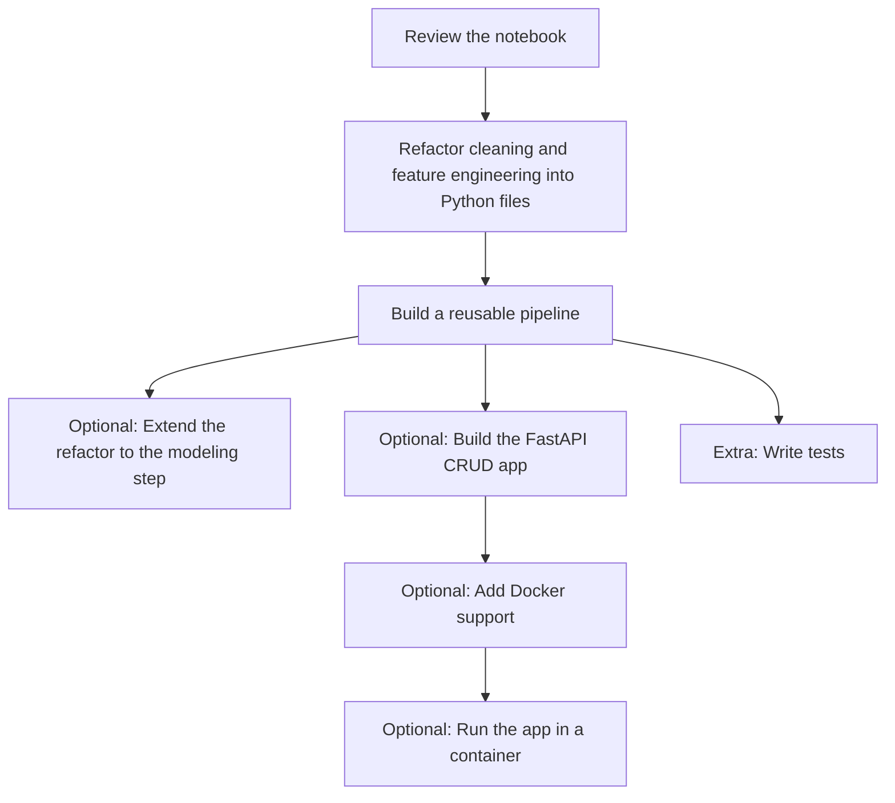

# Project Description

You will work with the [King County Jupyter notebook](./King-County.ipynb), which already contains exploratory data analysis, data cleaning, feature engineering, and several Machine Learning models.

The main focus of this project is the refactoring of the data cleaning and feature engineering workflow. The modeling section stays in the notebook so you can see how those transformed features are used later in a full Machine Learning workflow.

## Main Tasks

- Refactor the data cleaning and feature engineering code into Python files.
- Build a reusable pipeline for data cleaning and feature engineering.

### Stretch Tasks

- Refactor the modeling step as well, or extend your pipeline so it also supports the training workflow.
- Build a FastAPI app that supports Create, Read, Update and Delete operations for houses stored in a database, using 5 features.
- Create a `Dockerfile` for the app.
- Run the app inside a Docker container.

If you want a working reference for this optional stretch goal, see [bonus_solution/](./bonus_solution/). It includes a minimal FastAPI + Postgres + Docker example and is meant as a guide, not a required structure.

### Extra (if you still have time)

- Write tests.

## Workflow

## Answer the following questions

- What steps did you take to complete the project?
- What challenges did you face?
- What would you do differently if you had more time?

## Reflection

### What steps did you take to complete the project?

1. **Reviewed the notebook.** I worked through `King-County.ipynb` and marked which cells only inspect the data (EDA, plots, maps) and which cells change it (cleaning and feature engineering).
2. **Refactored data cleaning into `cleaning.py`.** Each cleaning step became its own function: removing the implausible house with 33 bedrooms, recalculating `sqft_basement`, filling missing values in `view` and `waterfront`, and combining `yr_built` and `yr_renovated` into `last_known_change`. A `cleaning_pipeline` function runs all steps in the original order.
3. **Refactored feature engineering into `feature_engineering.py`.** I extracted the price per square foot, the distance to the wealth center in Medina, a reusable distance helper and the distance to the nearest waterfront house. A `feature_engineering` function runs these steps in order.
4. **Connected the notebook to the pipeline.** The notebook now imports both pipeline functions instead of containing the original code. The exploration and modeling cells stay in the notebook.
5. **Built a FastAPI CRUD app for houses.** The app in `app/` stores houses with five features (`bedrooms`, `bathrooms`, `sqft_living`, `grade`, `zipcode`) in PostgreSQL. It is split into `database.py` (connection and sessions), `models.py` (SQLAlchemy table), `schemas.py` (Pydantic validation for input and output) and `main.py` (endpoints to create, read, update and delete houses). I ran PostgreSQL in a Docker container and tested every endpoint through the Swagger UI, including invalid input (422) and unknown IDs (404).

### What challenges did you face?

- **Side effects in functions.** At first my functions changed the DataFrame that was passed in. I learned why each function should start with `data.copy()` and why assigning results (`data = data.drop(...)`) is clearer than `inplace=True`. Removing `inplace=True` without assigning the result also silently kept columns I meant to drop.
- **Nested loops and indentation.** The waterfront distance uses a loop inside a loop. A wrong indentation level produced a list with 3,153,016 values instead of 21,596, one per house and waterfront house instead of one per house. The number in the error message helped me find the cause.
- **Separating models and schemas.** It took time to understand why the API needs both SQLAlchemy models (how data is stored) and Pydantic schemas (what clients may send and receive), and why the input schema must not contain the `id`.

### What would you do differently if you had more time?

- **Speed up the waterfront distance.** The nested loop runs over three million distance calculations. A vectorized NumPy version would compute the same values much faster.
- **Make the pipeline usable for new data.** `sqft_price` is calculated from the price, so it cannot be part of a pipeline that prepares data for predictions. The waterfront distance should receive fixed reference coordinates from the training data instead of deriving them from the data being transformed.
